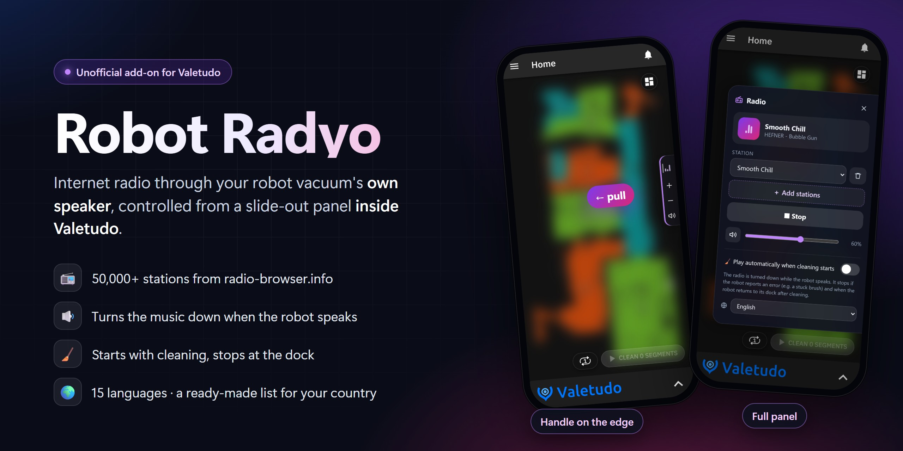
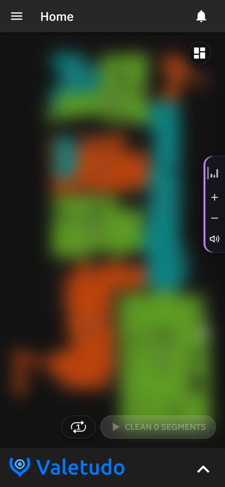
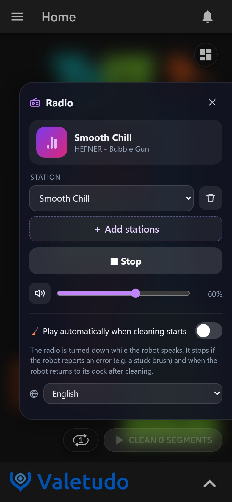
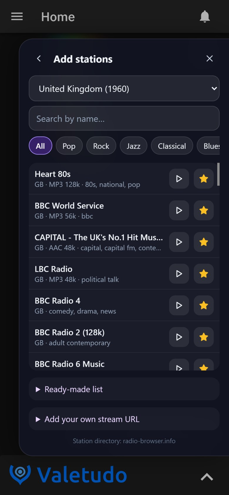
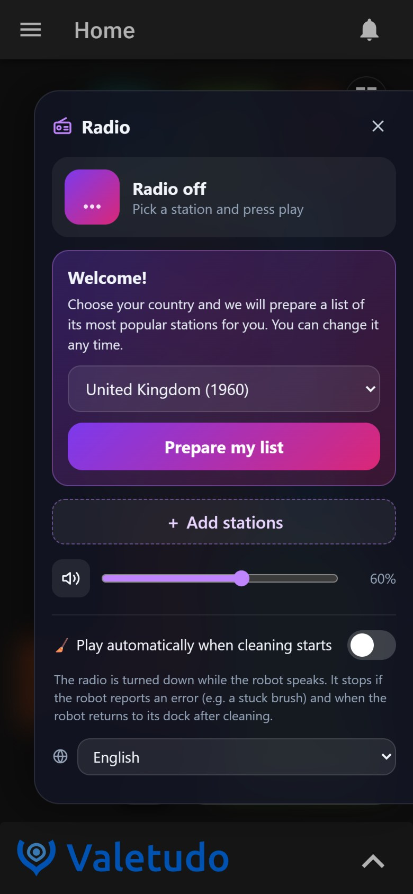
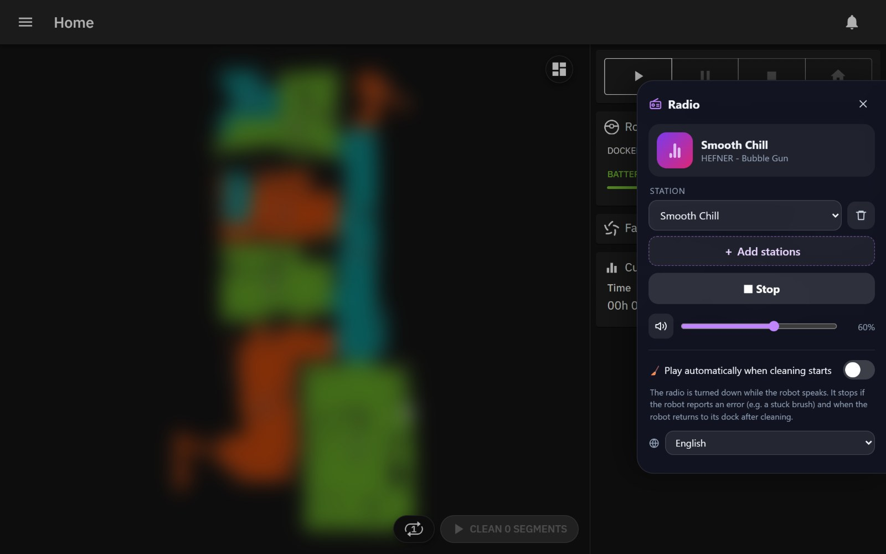

<p align="center">
  
</p>

<p align="center">
  <a href="LICENSE"></a>
  
  
  
  <a href="README.tr.md"></a>
</p>

**Robot Radyo plays internet radio through your robot vacuum's own speaker.** You control it from a panel that slides out of the right edge of the Valetudo web interface, like a Samsung Edge panel.

> ⚠️ **Unofficial.** This project is not affiliated with or supported by [Valetudo](https://valetudo.cloud). Please don't ask the Valetudo maintainers for help with it. It changes your robot's sound configuration; use it at your own risk.

## Screenshots

<table>
  <tr>
    <td align="center"><br><sub>Handle on the edge</sub></td>
    <td align="center"><br><sub>Full panel</sub></td>
    <td align="center"><br><sub>Add stations</sub></td>
    <td align="center"><br><sub>First run</sub></td>
  </tr>
</table>

<p align="center"></p>
<p align="center"><sub>The robot's map is blurred on purpose in these screenshots.</sub></p>

## What it does

- **Radio panel inside Valetudo.** Open your Valetudo page on port `8080` and pull the handle on the right edge. Volume up, volume down and mute sit right on the handle.
- **Any station in the world.** Stations come from the open [radio-browser.info](https://www.radio-browser.info) directory (50,000+ stations, 220+ countries). You can search by country, genre or name, preview a station and star your favourites. You can also add your own stream URL.
- **Ready-made list on first run.** Pick your country, and the panel builds a list from its most-listened stations:
  - a "Popular" group;
  - genre groups (pop, rock, oldies, chill, folk and local music, jazz and classical, news and sports, religious);
  - a few well-known international jazz, classical and chill stations.

  Countries with only a few stations are topped up with stations in the same language. Every station is test-played silently in the background. A broken station is replaced from the same group; if there is no replacement, it stays in the list marked ⚠. Nothing is changed while the internet is down.
- **Works with the robot's own voice.** The robot and the radio share the sound card. When the robot speaks, the radio is turned down (about −30 dB) and fades back afterwards.
- **Follows cleaning (optional).**
  - The radio can start when you start a cleaning.
  - It stops when the robot is back on its dock, and when the robot reports an error (after the robot has spoken its warning).
  - Cleanings started by a **Valetudo timer** do not start the radio unless you turn on "Also for scheduled cleanings". Nobody is usually home then.
- **Self-healing station list.** Favourites are stored by their radio-browser ID. If a station changes its stream address, the new one is looked up automatically.
- **15 interface languages.** See [Languages and translations](#languages-and-translations).
- **Runs entirely on the robot.** After installation there is no cloud, phone app or PC involved. There are no npm dependencies and no telemetry, and the panel loads nothing from third-party servers.

## What changes on your robot

| | |
|---|---|
| **New service** | A small web server on port 8080 that runs as root, like Valetudo. `/etc/init/S12robotradyo` starts it at boot. |
| **Sound setup** | `/etc/asound.conf` routes the robot's sound through a software mixer (ALSA `dmix`), so its voice and the radio can play together. An existing file is backed up first. |
| **Files** | About 85 MB in `/mnt/data/robot-radyo`: Node.js, ffmpeg, aplay/amixer and the app. |
| **Valetudo** | Not modified. It is still reachable on port 80 as before. |
| **Undo** | Run `bash uninstall.sh …` and reboot once to get the original state back. Cleaning itself never depends on the add-on. |

## Compatibility

| Robot | Status |
|---|---|
| Roborock S5 (gen2), firmware 3.5.8_002034, Valetudo 2026.10.0 | ✅ tested |
| Xiaomi Mi Robot Vacuum (gen1) with Valetudo | 🟡 same platform, untested |
| Other robots | ❌ not yet, see [Porting](#porting-to-other-robots) |

The installer checks the robot first and refuses to install on anything else.

## Requirements

**A computer** with Linux, macOS, WSL or Git Bash on Windows, and these tools:
- `bash`, `ssh`, `curl`, `tar` with xz support, and `sha256sum` or `shasum`;
- one of `ar`, `bsdtar` or `python3`.

Git Bash on Windows has everything.

**Root SSH access to the robot with a key.** You already have this if you rooted the robot for Valetudo.
- Log in once by hand first (`ssh -i KEY root@ROBOT`), so the robot's host key is known. The installer never asks for passwords.
- For a custom port or old SSH algorithms, use `~/.ssh/config`.

**Internet access:**
- the computer downloads about 100 MB;
- the robot needs internet for the radio itself.

## Install

```bash
git clone https://github.com/n920aziz-coder/robot-radyo.git
cd robot-radyo
bash install.sh --dry-run -i ~/.ssh/your_robot_key 192.168.1.50   # optional: checks and downloads, changes nothing
bash install.sh --reboot  -i ~/.ssh/your_robot_key 192.168.1.50
```

Then open `http://<robot-ip>:8080`. If you use Valetudo's login, log in with your Valetudo user name and password. Pull the handle on the right edge, pick your country and press **Prepare my list**.

The installer goes through these steps:

1. It downloads static builds of [Node.js](https://github.com/yao-pkg/pkg-fetch) and [ffmpeg](https://johnvansickle.com/ffmpeg/), `aplay`/`amixer` from the Ubuntu 14.04 archive, and a current CA bundle from [curl.se](https://curl.se/docs/caextract.html). Each download is checked against a pinned or published checksum.
2. It copies everything to the robot and checks that the programs run there. Only then does it replace an existing installation. Favourite stations and settings are kept.
3. It installs the sound setup and the boot script. It then plays 0.1 s of silence through the shared sound device. If that fails, it puts the previous sound settings back and stops.

**Reboot the robot once** (`--reboot`; do it while the robot is docked, not cleaning). After the reboot the robot's own sound program uses the shared sound card. Until then, the robot's voice is silent while the radio plays.

Options: `--dir`, `--port` (default 8080), `-i KEY`, `--dry-run` and `--reboot`. Download sources can be overridden with environment variables such as `NODE_URL` or `FFMPEG_URL`; see the top of `install.sh`.

### Update

```bash
cd robot-radyo && git pull
bash install.sh -i ~/.ssh/your_robot_key 192.168.1.50
```

You can safely re-run the installer; favourite stations and settings are kept.

**After a robot firmware update, run the installer again.** A firmware update replaces `/etc`, which removes the boot script and the sound setup. The files in `/mnt/data` stay.

### Uninstall

```bash
bash uninstall.sh -i ~/.ssh/your_robot_key 192.168.1.50
```

Reboot the robot once afterwards. Add `--yes` to skip the confirmation.

## How it works

```
browser ──► :8080 Robot Radyo (Node.js) ──► :80 Valetudo        (Valetudo is passed through unchanged; the panel script is added to the page)
                 │
                 ├─ ffmpeg (stream → PCM) ─► aplay ─► "Radyo Ses" ─► "Radyo" ─► dmix ─► speaker
                 │                                     volume        ducking     ▲
                 │                                                               │
                 └─ watches the robot's voice process ──────────────── robot voice ┘
```

- **Sound card sharing.** The robot's sound library opens the ALSA device `default`. `/etc/asound.conf` turns `default` into a `dmix` mixer, so the robot's voice and the radio can play at the same time.
- **Volume and ducking** use two `softvol` controls right in front of the mixer, so changes are heard within about 0.2 s. A short silent playback creates the controls at start-up, because no other program can change a softvol control while the program that created it is running.
- **The audio** goes straight from ffmpeg to aplay; it does not pass through Node.js.
- **Robot speaking** is detected when the robot's voice process (`RoboController`) opens the sound card.
- **Robot state** (cleaning, docked, error) comes from Valetudo's API.
  - If Valetudo's login is off (its default), this works right away.
  - If the login is on, the add-on reuses the login that your browser sends when you open the page on port 8080. It keeps it in memory only: it is never written to disk and only ever sent to Valetudo on the robot itself. So after a robot restart, the automations start working once the page has been opened on port 8080.
  - The add-on never reads your password from anywhere.
- **Scheduled cleanings.** When a cleaning starts, the add-on looks at Valetudo's timers. If a timer fired in the last 3 minutes, the cleaning counts as scheduled. Cleanings started by Home Assistant or MQTT automations count as manual.

## Resource usage

Measured on a Roborock S5 (4-core ARM Cortex-A7, 512 MB RAM) while docked:

| | Radio off | Radio playing |
|---|---|---|
| CPU, share of the whole processor | about 0.3 % | about 2.4 % (about 10 % of one core) |
| RAM | 26–42 MB | 7 MB more (ffmpeg ≈ 5.5 MB, aplay ≈ 1 MB) |
| Storage in `/mnt/data` | about 85 MB | same |

The robot always comes first:

- **Priority.** The robot's own programs run at the highest priority (nice −20). The radio runs at nice 10, so when the processor is busy, practically all of its time goes to the robot.
- **Out of memory.** If memory runs out, the kernel stops the radio first (`oom_score_adj` 1000), not the robot's programs or Valetudo. If the server dies abruptly, its leftover audio process is stopped too.
- **Self-limits.** The radio stops itself if the robot's available memory drops below 40 MB. The server restarts itself if its own memory grows unusually (above 100 MB).
- **Background work.** Station tests run at the lowest priority (nice 19).
- **Log and settings.** The log is kept in RAM (`/tmp`) and trimmed to 256 KB. Settings are written to flash only when you change them.
- **Live measurements.** The server keeps its own measurements, including the highest load seen during cleaning. Open `http://<robot-ip>:8080/robot-radyo/api/durum` while logged in and look at `kaynak`:

  | Field | Meaning |
  |---|---|
  | `sistemCpu` / `radyoCpu` | whole system / radio CPU in % |
  | `radyoRamMB` | the radio's memory |
  | `kullanilabilirRamMB` | the robot's available memory |
  | `temizlikteEnYuksek…` | peaks while cleaning |

## Privacy and security

- **What leaves your network.** Searching and starting a station contact radio-browser.info. When you start a station, it is reported as a "click", as the directory asks apps to do; background station tests don't count as clicks. No personal data is sent. As with any radio app, the robot's public IP is visible to the directory and to the radio station.
- **Who can reach port 8080.** Port 8080 follows Valetudo's "LAN only" rule. When Valetudo's login is on, everything except the two panel scripts needs that login.
- **Protection against other websites.** Requests that change something are only accepted as JSON from the page itself. Other websites you visit can't control the radio through your browser.
- **Root and ffmpeg.** The add-on runs as root, as Valetudo does. ffmpeg may only open network streams (http/https), so a playlist can't make it read local files.
- **Station content.** The project only plays streams that stations publish openly for listening. It does not record, rebroadcast or bypass any protection. The repository contains no station list: the ready-made list is built on the robot from the directory's current listening figures.
- **Licensing.** Respect each station's terms of use. Playing radio in a shop, café or other commercial venue usually needs a separate licence.

## Troubleshooting

| Problem | What to do |
|---|---|
| No radio panel | Open Valetudo on port **8080** (`http://<robot-ip>:8080`), not port 80. |
| The robot's voice is silent while the radio plays | Reboot the robot once after installing. |
| The radio doesn't start or stop with cleaning | If Valetudo's login is on, open the page on port 8080 once after each robot restart. A cleaning started by a Valetudo timer only starts the radio if "Also for scheduled cleanings" is on. |
| `Permission denied` or `Host key verification failed` during install | Log in once by hand with `ssh -i KEY root@ROBOT`; the installer needs key-based root login. |
| A station doesn't play | It may be offline. The list repairs itself where it can; pick another station. |
| Anything else | Look at the log on the robot (`tail -50 /tmp/robot-radyo.log`) and restart the add-on with `/etc/init/S12robotradyo restart`. |

## Languages and translations

English, Türkçe, Deutsch, Français, Español, Italiano, Português, Nederlands, Polski, Русский, Українська, العربية, 中文, 日本語, 한국어. The panel follows the browser language, and you can switch it in the panel.

English and Turkish are the project's original languages. The other 13 translations were written carefully with AI assistance, specifically for this interface, but no native speaker has reviewed them yet. Corrections are very welcome; see [CONTRIBUTING.md](CONTRIBUTING.md). All texts are in `robot/web/i18n.js`.

## Porting to other robots

Only a few parts are robot-specific:

- the CPU builds (`NODE_URL`, `FFMPEG_URL`, alsa-utils for armv7);
- the boot mechanism (`/etc/init/rcS` → `S12robotradyo`);
- the sound card and process names in `robot/web/server.mjs` (`/dev/snd/pcmC0D0p`, `RoboController`).

Pull requests for other models are welcome.

## Help and contributing

- **Questions and bug reports:** use this repository's [Issues](https://github.com/n920aziz-coder/robot-radyo/issues). Please don't ask the Valetudo maintainers; this is not their project.
- **Contributions:** see [CONTRIBUTING.md](CONTRIBUTING.md).
- **Security problems:** see [SECURITY.md](SECURITY.md).

The code comments are mostly in Turkish. Issues and pull requests are welcome in English or Turkish.

## Credits

[radio-browser.info](https://www.radio-browser.info) · [Valetudo](https://valetudo.cloud) · [ffmpeg](https://ffmpeg.org) static builds by John Van Sickle · [yao-pkg/pkg-fetch](https://github.com/yao-pkg/pkg-fetch) static Node.js builds · ALSA / alsa-utils

## License

MIT, see [LICENSE](LICENSE). The downloaded third-party programs keep their own licences (ffmpeg and alsa-utils: GPL; Node.js: MIT). They are downloaded from their original sources and are not redistributed by this repository.
