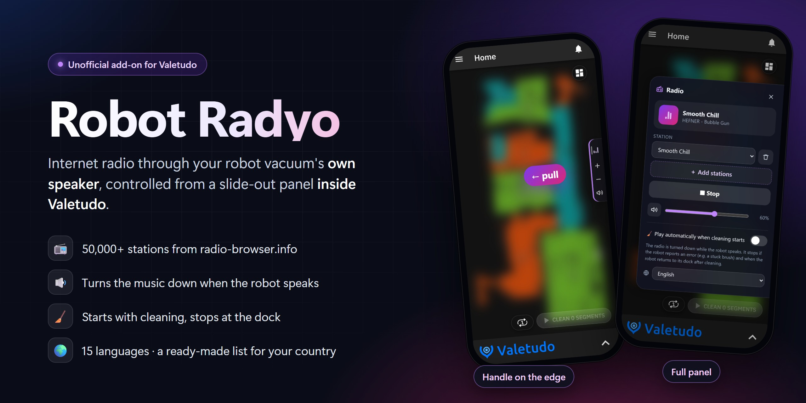
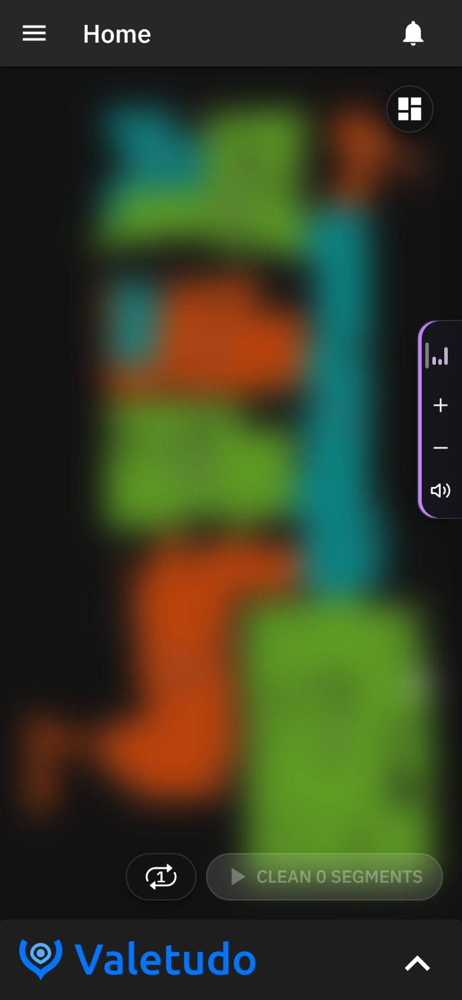
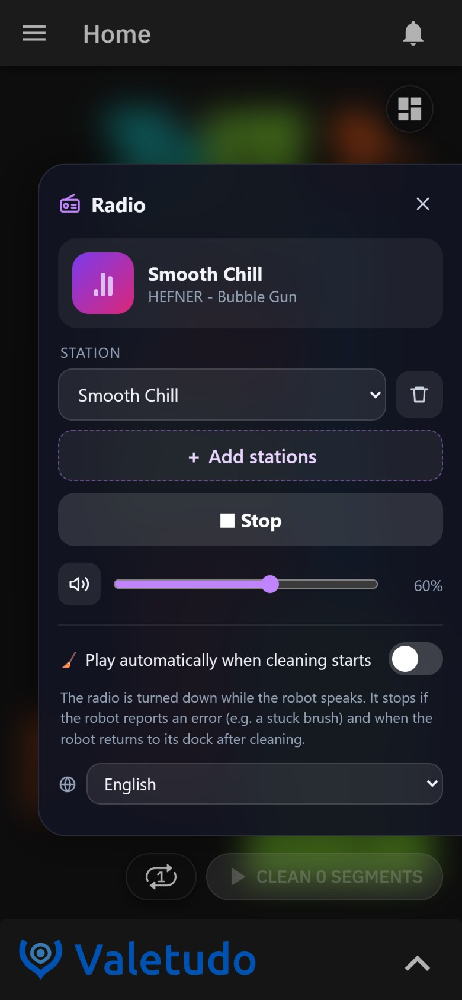
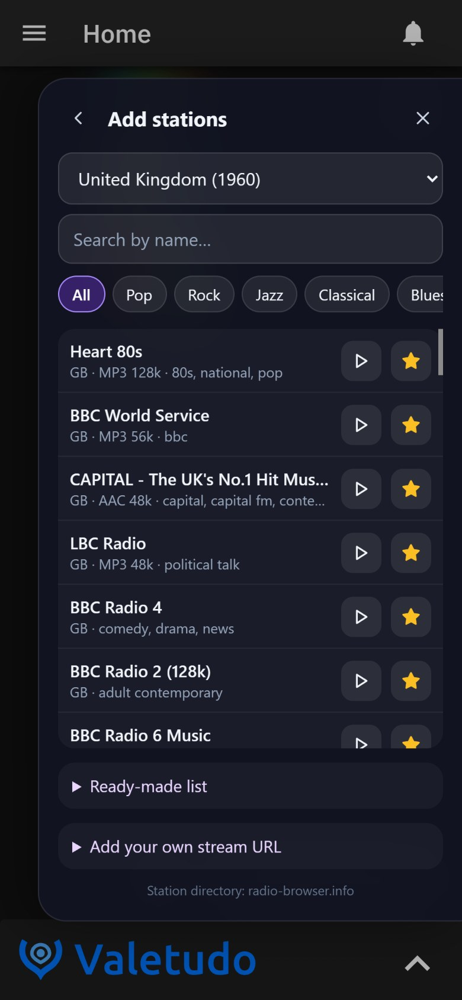
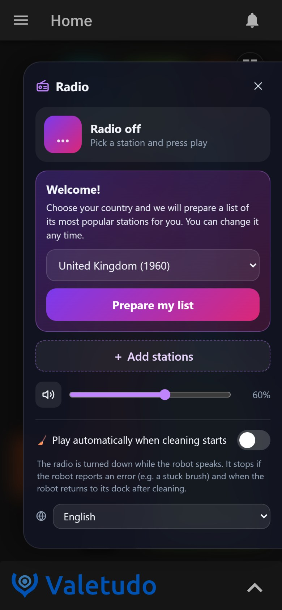
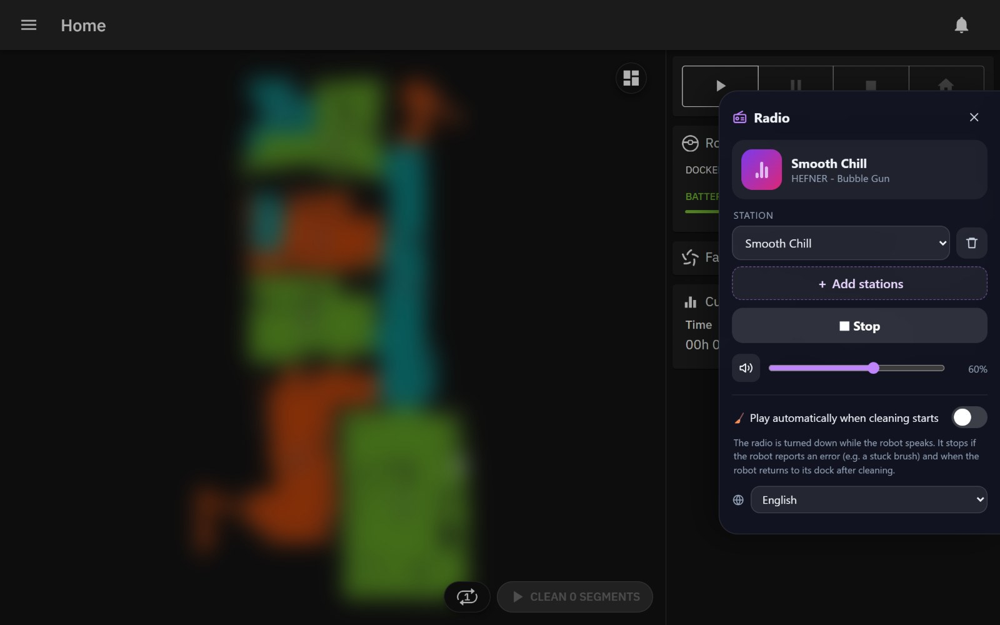

<p align="center">
  
</p>

<p align="center">
  <a href="LICENSE"></a>
  
  
  
  <a href="README.md"></a>
</p>

**Robot Radyo, internet radyosunu robot süpürgenizin kendi hoparlöründen çalar.** Valetudo arayüzünün sağ kenarından çekilen bir panelle yönetilir (Samsung Edge paneli gibi).

> ⚠️ **Resmi değildir.** Bu proje [Valetudo](https://valetudo.cloud) ile bağlantılı değildir ve onlar tarafından desteklenmez. Sorularınız için lütfen Valetudo geliştiricilerine başvurmayın. Robotun ses ayarlarını değiştirir; kullanım sorumluluğu size aittir.

## Ekran görüntüleri

<table>
  <tr>
    <td align="center"><br><sub>Kenardaki tutamaç</sub></td>
    <td align="center"><br><sub>Panelin tamamı</sub></td>
    <td align="center"><br><sub>Radyo ekleme</sub></td>
    <td align="center"><br><sub>İlk açılış</sub></td>
  </tr>
</table>

<p align="center"></p>
<p align="center"><sub>Ekran görüntülerinde robotun haritası bilerek bulanıklaştırıldı. Görüntüler İngilizce arayüzle alındı.</sub></p>

## Neler yapar

- **Valetudo'nun içinde radyo paneli.** Valetudo sayfanızı `8080` portundan açın ve sağ kenardaki tutamacı çekin. Ses açma, kısma ve sessiz düğmeleri doğrudan tutamacın üstünde.
- **Dünyanın her yerinden radyo.** İstasyonlar açık [radio-browser.info](https://www.radio-browser.info) dizininden gelir (50.000'den fazla istasyon, 220'den fazla ülke). Ülkeye, türe ya da isme göre arayabilir, önizleyebilir ve favorilerinize ekleyebilirsiniz. Kendi yayın adresinizi de ekleyebilirsiniz.
- **İlk açılışta hazır liste.** Ülkenizi seçtiğinizde panel, o ülkede en çok dinlenen radyolardan bir liste hazırlar:
  - bir "Popüler" grubu;
  - tür grupları (pop, rock, nostalji, sakin, halk ve yerel, caz ve klasik, haber ve spor, dini);
  - tanınmış birkaç yabancı caz, klasik ve sakin müzik radyosu.

  Az radyosu olan ülkelerde liste aynı dildeki radyolarla tamamlanır. Her radyo arka planda sessizce denenir; çalışmayanın yerine aynı gruptan başkası konur.
- **Robotun kendi sesiyle uyumlu.** Robot ve radyo ses kartını paylaşır. Robot konuşurken radyo kısılır (yaklaşık −30 dB), sonra yavaşça eski sesine döner.
- **Temizliğe göre çalışır (isteğe bağlı).**
  - Siz temizliği başlatınca radyo kendiliğinden açılabilir.
  - Robot şarj istasyonuna dönünce kapanır. Robot hata verirse de, uyarısını söyledikten sonra kapanır.
  - **Valetudo zamanlayıcısıyla** başlayan temizliklerde radyo açılmaz; "Zamanlanmış temizliklerde de" seçeneğini açarsanız açılır. O saatlerde evde genellikle kimse olmaz.
- **Kendini onaran istasyon listesi.** Favoriler radio-browser'daki kalıcı kimlikleriyle tutulur. Bir radyo yayın adresini değiştirirse yenisi kendiliğinden bulunur.
- **15 dilde arayüz.** Ayrıntılar [Diller ve çeviriler](#diller-ve-çeviriler) bölümünde.
- **Her şey robotun içinde çalışır.** Kurulumdan sonra bulut, telefon uygulaması ya da bilgisayar gerekmez. npm bağımlılığı ve kullanım verisi toplama yoktur; panel başka sunuculardan hiçbir şey yüklemez.

## Robotunuzda neler değişir

| | |
|---|---|
| **Yeni hizmet** | 8080 portunda küçük bir web sunucusu. Valetudo gibi root olarak çalışır; açılışta `/etc/init/S12robotradyo` başlatır. |
| **Ses ayarı** | `/etc/asound.conf`, robotun sesini bir yazılım karıştırıcısından (ALSA `dmix`) geçirir; böylece robotun sesi ve radyo birlikte çalabilir. Önceden bir dosya varsa yedeklenir. |
| **Dosyalar** | `/mnt/data/robot-radyo` içinde yaklaşık 85 MB: Node.js, ffmpeg, aplay/amixer ve uygulama. |
| **Valetudo** | Değiştirilmez; 80 portunda eskisi gibi çalışır. |
| **Geri alma** | `bash uninstall.sh …` ve bir yeniden başlatma her şeyi eski haline getirir. Temizlik hiçbir zaman eklentiye bağlı değildir. |

## Uyumluluk

| Robot | Durum |
|---|---|
| Roborock S5 (2. nesil), yazılım 3.5.8_002034, Valetudo 2026.10.0 | ✅ denendi |
| Xiaomi Mi Robot Vacuum (1. nesil), Valetudo | 🟡 aynı altyapı, denenmedi |
| Diğer robotlar | ❌ henüz değil; [Başka robotlara uyarlama](#başka-robotlara-uyarlama) bölümüne bakın |

Kurulum betiği önce robotu kontrol eder, uyumsuz bir robota kurulum yapmaz.

## Gerekenler

**Bilgisayar:** Linux, macOS, WSL ya da Windows'ta Git Bash; üzerinde şu araçlar olmalı:
- `bash`, `ssh`, `curl`, xz destekli `tar`, `sha256sum` ya da `shasum`;
- `ar`, `bsdtar` ya da `python3`'ten biri.

Windows'taki Git Bash'te hepsi var.

**Robota anahtarla root SSH erişimi.** Robotu Valetudo için hazırladıysanız bu erişim zaten sizde vardır.
- Önce bir kez elle bağlanın (`ssh -i ANAHTAR root@ROBOT`); böylece robotun sunucu anahtarı tanınır. Kurulum betiği hiçbir zaman şifre sormaz.
- Farklı bir port ya da eski SSH algoritmaları için `~/.ssh/config` dosyasını kullanın.

**İnternet erişimi:**
- bilgisayar yaklaşık 100 MB indirir;
- robotun da radyo için internete çıkabilmesi gerekir.

## Kurulum

```bash
git clone https://github.com/n920aziz-coder/robot-radyo.git
cd robot-radyo
bash install.sh --dry-run -i ~/.ssh/robot_anahtariniz 192.168.1.50   # isteğe bağlı: kontrol eder ve indirir, hiçbir şeyi değiştirmez
bash install.sh --reboot  -i ~/.ssh/robot_anahtariniz 192.168.1.50
```

Ardından `http://<robot-ip>:8080` adresini açın. Valetudo'da giriş kullanıyorsanız Valetudo kullanıcı adı ve şifrenizle girin. Sağ kenardaki tutamacı çekin, ülkenizi seçip **Listemi hazırla**'ya basın.

Kurulum betiği sırasıyla şunları yapar:

1. [Node.js](https://github.com/yao-pkg/pkg-fetch) ve [ffmpeg](https://johnvansickle.com/ffmpeg/) için statik derlemeleri, Ubuntu 14.04 arşivinden `aplay`/`amixer` araçlarını ve [curl.se](https://curl.se/docs/caextract.html)'den güncel sertifika listesini indirir. Her indirmeyi sabit ya da yayımlanmış bir doğrulama değeriyle kontrol eder.
2. Hepsini robota kopyalar ve programların orada çalıştığını denetler. Varsa çalışan kurulumu ancak bundan sonra değiştirir. Favori radyolar ve ayarlar korunur.
3. Ses ayarını ve açılış betiğini kurar. Ardından ortak ses cihazından 0,1 saniyelik sessizlik çalar. Bu başarısız olursa önceki ses ayarlarını geri koyar ve durur.

**Robotu bir kez yeniden başlatın** (`--reboot`; robot şarj istasyonundayken, temizlik yapmıyorken). Yeniden başladıktan sonra robotun kendi ses programı paylaşılan ses kartını kullanır. O zamana kadar radyo çalarken robotun sesi duyulmaz.

Seçenekler: `--dir`, `--port` (varsayılan 8080), `-i ANAHTAR`, `--dry-run` ve `--reboot`. İndirme kaynakları ortam değişkenleriyle (`NODE_URL`, `FFMPEG_URL` gibi) değiştirilebilir; ayrıntılar `install.sh` dosyasının başında.

### Güncelleme

```bash
cd robot-radyo && git pull
bash install.sh -i ~/.ssh/robot_anahtariniz 192.168.1.50
```

Kurulum betiğini tekrar çalıştırmak güvenlidir; favori radyolar ve ayarlar korunur.

**Robotun yazılımı güncellenirse kurulum betiğini yeniden çalıştırın.** Yazılım güncellemesi `/etc` klasörünü yeniler; açılış betiği ve ses ayarı silinir. `/mnt/data` içindeki dosyalar kalır.

### Kaldırma

```bash
bash uninstall.sh -i ~/.ssh/robot_anahtariniz 192.168.1.50
```

Ardından robotu bir kez yeniden başlatın. Onay sorusunu atlamak için `--yes` ekleyebilirsiniz.

## Nasıl çalışır

```
tarayıcı ──► :8080 Robot Radyo (Node.js) ──► :80 Valetudo        (Valetudo olduğu gibi aktarılır; sayfaya panel betiği eklenir)
                 │
                 ├─ ffmpeg (yayın → PCM) ─► aplay ─► "Radyo Ses" ─► "Radyo" ─► dmix ─► hoparlör
                 │                                     ses ayarı     kısma       ▲
                 │                                                               │
                 └─ robotun ses programını izler ──────────────────── robotun sesi ┘
```

- **Ses kartı paylaşımı.** Robotun ses kütüphanesi ALSA'nın `default` cihazını açar. `/etc/asound.conf` bu cihazı bir `dmix` karıştırıcıya yönlendirir; böylece robotun sesi ve radyo aynı anda çalabilir.
- **Ses ayarı ve kısma**, karıştırıcının hemen önündeki iki `softvol` kanalıyla yapılır; değişiklikler yaklaşık 0,2 saniyede duyulur. Bir softvol kanalını, onu oluşturan program çalıştığı sürece başka program değiştiremez. Bu yüzden kanallar açılışta kısa bir sessiz denemeyle önceden oluşturulur.
- **Ses verisi** ffmpeg'den aplay'e doğrudan akar, Node.js'in içinden geçmez.
- **Robotun konuştuğu**, robotun ses programı (`RoboController`) ses kartını açtığında anlaşılır.
- **Robotun durumu** (temizliyor, şarj istasyonunda, hata) Valetudo'nun arayüzünden okunur.
  - Valetudo'nun girişi kapalıysa (varsayılan budur) bu hemen çalışır.
  - Giriş açıksa, sayfayı 8080'den açtığınızda tarayıcınızın gönderdiği giriş kullanılır. Bu bilgi yalnızca bellekte tutulur: diske yazılmaz, yalnızca robotun içindeki Valetudo'ya gönderilir. Bu yüzden robot yeniden başladıktan sonra otomatik özellikler, sayfa 8080'den bir kez açılınca devreye girer.
  - Eklenti şifrenizi hiçbir yerden okumaz.
- **Zamanlanmış temizlikler.** Temizlik başladığında Valetudo'nun zamanlayıcılarına bakılır. Son 3 dakika içinde bir zamanlayıcı çalıştıysa temizlik zamanlanmış sayılır. Home Assistant ya da MQTT otomasyonlarıyla başlatılan temizlikler elle başlatılmış sayılır.

## Kaynak kullanımı

Roborock S5 üzerinde (4 çekirdekli ARM Cortex-A7, 512 MB RAM), robot şarj istasyonundayken ölçüldü:

| | Radyo kapalı | Radyo çalarken |
|---|---|---|
| İşlemci, tüm işlemcinin yüzdesi | yaklaşık %0,3 | yaklaşık %2,4 (tek çekirdeğin yaklaşık %10'u) |
| RAM | 26–42 MB | 7 MB daha (ffmpeg ≈ 5,5 MB, aplay ≈ 1 MB) |
| `/mnt/data` içinde yer | yaklaşık 85 MB | aynı |

Robot her zaman önce gelir:

- **Öncelik.** Robotun kendi programları en yüksek öncelikle çalışır (nice −20). Radyo nice 10 ile çalışır; işlemci yoğunken zamanın neredeyse tamamı robota gider.
- **Bellek biterse.** Çekirdek önce radyoyu kapatır (`oom_score_adj` 1000); robotun programlarına ve Valetudo'ya dokunmaz. Sunucu aniden kapanırsa geride kalan ses süreci de kapatılır.
- **Kendi sınırları.** Robotun kullanılabilir belleği 40 MB'ın altına inerse radyo kendini kapatır. Sunucunun kendi belleği olağandışı büyürse (100 MB'ın üstü) sunucu kendini yeniden başlatır.
- **Arka plan işleri.** Radyo denemeleri en düşük öncelikle çalışır (nice 19).
- **Günlük ve ayarlar.** Günlük (log) dosyası bellekte (`/tmp`) tutulur ve 256 KB ile sınırlanır. Ayarlar yalnızca siz değiştirdiğinizde kalıcı belleğe yazılır.
- **Canlı ölçümler.** Sunucu kendi ölçümlerini tutar; temizlik sırasında görülen en yüksek yük de bunlara dahildir. Giriş yapmışken `http://<robot-ip>:8080/robot-radyo/api/durum` adresini açıp `kaynak` bölümüne bakın:

  | Alan | Anlamı |
  |---|---|
  | `sistemCpu` / `radyoCpu` | tüm sistemin / radyonun işlemci yüzdesi |
  | `radyoRamMB` | radyonun belleği |
  | `kullanilabilirRamMB` | robotun kullanılabilir belleği |
  | `temizlikteEnYuksek…` | temizlik sırasındaki en yüksek değerler |

## Gizlilik ve güvenlik

- **Ağınızın dışına ne çıkar.** Arama yapmak ve bir radyoyu başlatmak radio-browser.info'ya bağlanır. Bir radyoyu başlattığınızda, dizinin uygulamalardan istediği gibi bu bir "tıklama" olarak bildirilir; arka plandaki radyo denemeleri tıklama sayılmaz. Kişisel bilgi gönderilmez. Her radyo uygulamasında olduğu gibi robotun genel IP adresi dizine ve radyo istasyonuna görünür.
- **8080 portuna kim ulaşabilir.** 8080 portunda da Valetudo'nun "yalnızca ev ağından erişim" kuralı uygulanır. Valetudo'da giriş açıksa, iki panel betiği dışındaki her şey bu girişi ister.
- **Başka sitelere karşı koruma.** Değişiklik yapan istekler yalnızca sayfanın kendisinden ve JSON olarak kabul edilir. Ziyaret ettiğiniz başka siteler tarayıcınız üzerinden radyoyu yönetemez.
- **Root ve ffmpeg.** Eklenti, Valetudo gibi root olarak çalışır. ffmpeg yalnızca ağ yayınlarını (http/https) açabilir; bir yayın listesi ona yerel dosya okutamaz.
- **Yayın içeriği.** Proje yalnızca istasyonların dinlenmesi için açıkça yayımladığı yayınları çalar. Kayıt yapmaz, yeniden yayınlamaz, hiçbir korumayı aşmaz. Depoda hazır bir istasyon listesi yoktur; hazır liste, dizindeki güncel dinlenme sayılarına göre robotun üzerinde oluşturulur.
- **Lisans.** Her istasyonun kullanım koşullarına uyun. Dükkân, kafe gibi ticari bir mekânda radyo çalmak genellikle ayrı bir lisans gerektirir (Türkiye'de MESAM/MSG gibi).

## Sorun giderme

| Sorun | Ne yapmalı |
|---|---|
| Radyo paneli görünmüyor | Valetudo'yu 80 değil **8080** portundan açın (`http://<robot-ip>:8080`). |
| Radyo çalarken robotun sesi duyulmuyor | Kurulumdan sonra robotu bir kez yeniden başlatın. |
| Radyo temizlikle açılıp kapanmıyor | Valetudo'da giriş açıksa, robot her yeniden başladıktan sonra sayfayı 8080'den bir kez açın. Valetudo zamanlayıcısıyla başlayan temizlikte radyo yalnızca "Zamanlanmış temizliklerde de" açıksa çalar. |
| Kurulumda `Permission denied` ya da `Host key verification failed` | Önce `ssh -i ANAHTAR root@ROBOT` ile bir kez elle bağlanın; kurulum için anahtarla root girişi gerekir. |
| Bir radyo çalmıyor | Yayın kapalı olabilir. Liste yapabildiği kadarını kendisi onarır; başka bir radyo seçin. |
| Başka bir sorun | Robottaki günlüğe bakın (`tail -50 /tmp/robot-radyo.log`), eklentiyi `/etc/init/S12robotradyo restart` ile yeniden başlatın. |

## Diller ve çeviriler

English, Türkçe, Deutsch, Français, Español, Italiano, Português, Nederlands, Polski, Русский, Українська, العربية, 中文, 日本語, 한국어. Panel tarayıcının dilini kullanır; dili panelden de değiştirebilirsiniz.

Projenin asıl dilleri Türkçe ve İngilizcedir. Diğer 13 dilin çevirileri yapay zekâ yardımıyla, bu arayüz için özenle yazıldı; ama henüz o dili ana dili olarak konuşan biri tarafından kontrol edilmedi. Düzeltmeler memnuniyetle karşılanır; [CONTRIBUTING.md](CONTRIBUTING.md) dosyasına bakın. Bütün metinler `robot/web/i18n.js` dosyasında.

## Başka robotlara uyarlama

Robota özel kısımlar az sayıda:

- işlemciye uygun derlemeler (`NODE_URL`, `FFMPEG_URL`, armv7 için alsa-utils);
- açılışta başlatma yöntemi (`/etc/init/rcS` → `S12robotradyo`);
- `robot/web/server.mjs` içindeki ses kartı ve süreç adları (`/dev/snd/pcmC0D0p`, `RoboController`).

Başka modeller için katkılar (pull request) memnuniyetle karşılanır.

## Yardım ve katkı

- **Sorular ve hata bildirimleri:** bu deponun [Issues](https://github.com/n920aziz-coder/robot-radyo/issues) bölümünü kullanın. Lütfen Valetudo geliştiricilerine sormayın; bu onların projesi değil.
- **Katkı:** [CONTRIBUTING.md](CONTRIBUTING.md) dosyasına bakın.
- **Güvenlik sorunları:** [SECURITY.md](SECURITY.md) dosyasına bakın.

Koddaki açıklamalar çoğunlukla Türkçedir. Hata bildirimleri ve katkılar Türkçe ya da İngilizce olabilir.

## Teşekkürler

[radio-browser.info](https://www.radio-browser.info) · [Valetudo](https://valetudo.cloud) · John Van Sickle'ın [ffmpeg](https://ffmpeg.org) statik derlemeleri · [yao-pkg/pkg-fetch](https://github.com/yao-pkg/pkg-fetch) statik Node.js derlemeleri · ALSA / alsa-utils

## Lisans

MIT, bkz. [LICENSE](LICENSE). İndirilen üçüncü taraf programlar kendi lisanslarına tabidir (ffmpeg ve alsa-utils: GPL; Node.js: MIT). Bu programlar özgün kaynaklarından indirilir, bu depo tarafından dağıtılmaz.
